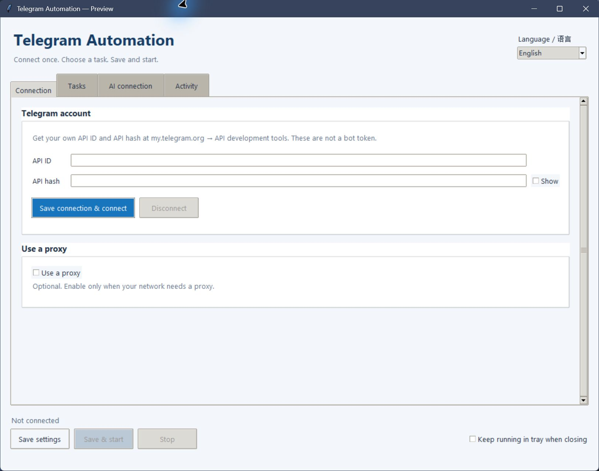
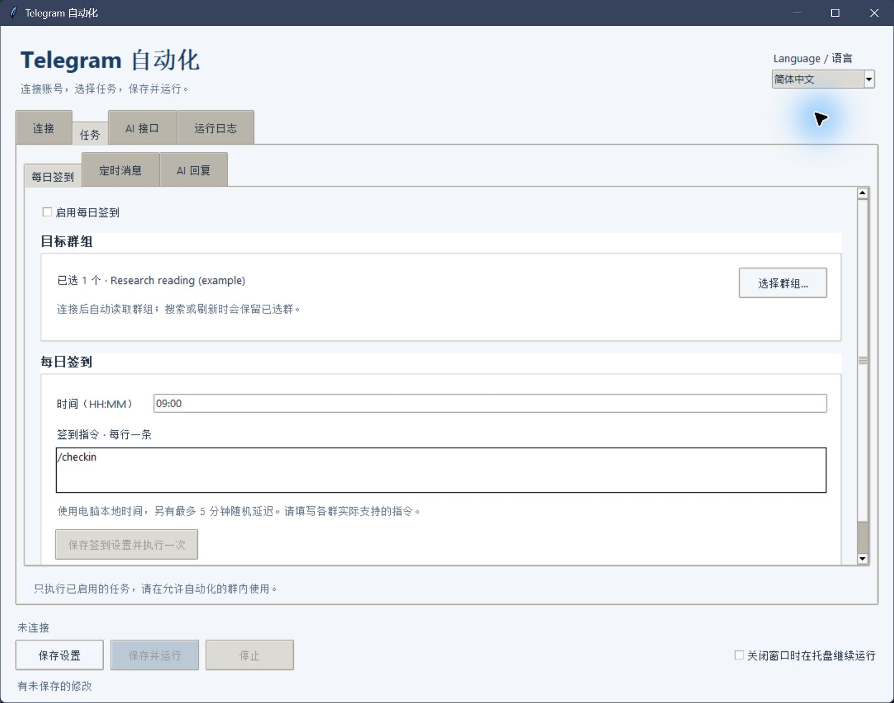
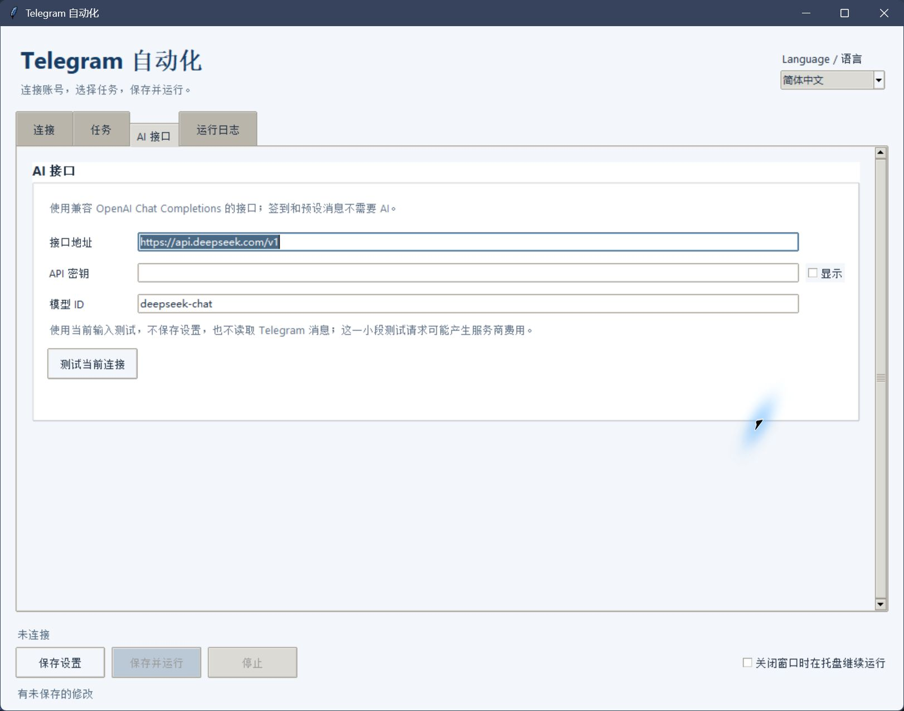

# Telegram Automation GUI

[简体中文](README.md) · **English**

Connect a Telegram account, select groups, schedule daily check-ins, and follow activity in one desktop window. Enable scheduled messages or AI replies when needed. Built with **Python, Telethon, and Tkinter**, with **English and Chinese interfaces**, using a personal Telegram account (userbot).

[Quick start](#quick-start) · [First run](#first-run) · [Language and saving](#language-and-saving) · [Troubleshooting](#troubleshooting) · [Report a problem](https://github.com/Marco0431/telegram-automation-gui/issues/new/choose)

This is a source-based desktop app for people whose groups permit automation. Login uses your Telegram application's `api_id` and `api_hash`, not a BotFather bot token.

## Interface preview

<table>
  <tr><th>Connection in English</th><th>The task after switching to Chinese</th></tr>
  <tr>
    <td><a href="docs/media/telegram-english.png"></a></td>
    <td><a href="docs/media/telegram-chinese.png"></a></td>
  </tr>
</table>

Click a screenshot for its full size. The [English task page](docs/media/telegram-tasks.png) shows the same settings; the group selection and custom command survive the language switch.


These are **offline previews** of the actual native UI. The group marked `example` is demo data, and `/checkin` is only an example command. Telegram is not signed in, no group messages or AI requests are sent, and all tasks are disabled.

## Quick start

You need Python 3, Tkinter, and a Telegram account. Sign in at Telegram's official [my.telegram.org](https://my.telegram.org), open **API development tools**, and create an application to obtain your own `api_id` and `api_hash`. Check-ins and the fixed message pool do not require an AI service.

```bash
git clone https://github.com/Marco0431/telegram-automation-gui.git
cd telegram-automation-gui
python -m pip install -r requirements.txt
python main.py
```

Without Git, use **Code → Download ZIP**, extract the files, and run the last two commands in that directory. Run `python -m tkinter` to check Tkinter; install it through your Python distribution or system package manager if missing. You can open the GUI without signing in to Telegram or providing an AI key.

You do not need to copy a configuration template to start. [config.py](config.py) defines runtime defaults; [config.example.json](config.example.json) is a reference. Review its proxy, task switches, and provider fields before using it.

A fresh configuration disables all tasks and the proxy, with an empty message pool. Enter your own commands or messages before enabling the tasks you need. Upgrading preserves existing task selections and text.

## First run

Start with one group and daily check-ins only:

1. Choose **English** in the language selector at the top.
2. Open **Connection** and enter your `api_id` and `api_hash`. Expand and enable proxy settings only if your connection needs a proxy, then select **Save connection & connect**. Follow the prompts for your phone number with country code, verification code, and two-step verification password if enabled. Connecting saves the connection settings; a successful login loads the group list automatically.
3. Open **Tasks → Daily check-in**, enable the task, and select **Choose groups**. Search for and select a group where check-ins are permitted, then confirm your selection. Enter the group's check-in command and a time in `HH:MM` format. Each task has its own group selector; there is no separate groups page.
4. Leave **Scheduled messages** and **AI replies** disabled. Select **Save & start** to validate and save settings, then run enabled tasks. Open **Activity** for status and the next check-in time. Use **Save settings** to save without starting tasks.
5. Select **Stop** to stop tasks. If background operation is enabled, closing the window keeps tasks running; restore the window from the system tray to stop them.

Check-ins use the computer's local time with an additional 0–5 minute delay. A time that has already passed is scheduled for the next day; starting tasks does not immediately send a check-in.

## Choose a task

| Goal | Settings | AI required |
| --- | --- | --- |
| Send daily check-in commands to selected groups | Tasks → Daily check-in: groups, commands, and time | No |
| Send messages from your own list at intervals | Tasks → Scheduled messages: groups, fixed message pool, intervals, and active hours | No |
| Generate scheduled group messages | Tasks → Scheduled messages: AI mode; configure the provider under AI connection | Yes |
| Reply to messages in selected groups | Tasks → AI replies: groups, trigger mode, and reply interval; configure the provider under AI connection | Yes |

Each task has its own enable switch and group selector. Configure only the tasks you need; disabled tasks do not require complete advanced settings. Scheduled-message active hours can cross midnight, such as 22:00 to 06:00 the next day.

## Language and saving

- **Language selector:** switches the interface immediately and remembers your choice. A new configuration follows the system language; an older configuration without a language field keeps Chinese.
- **Existing text:** switching languages preserves fields you are editing and custom text. Built-in AI prompts follow the interface language. Custom prompts, check-in commands, and message-pool entries are not translated or overwritten.
- **Save settings:** saves settings across all pages and reports the result in the interface, without a separate success dialog for every page.
- **Save & start:** validates and saves settings before starting enabled tasks. Missing required fields produce specific errors. Saving alone does not send group messages.
- **Editing while running:** stop tasks before saving new task settings. Your pending edits remain in the window.
- **Background operation:** this preference is saved with the configuration. When enabled, closing the window does not stop tasks; use Stop or quit from the tray.
- **Activity:** contains connection, task, and AI-test messages. The interface bounds the retained log history to avoid accumulating it indefinitely.

## AI connection

The **AI connection** page contains provider settings shared by scheduled AI messages and AI replies. Requests use the OpenAI Python SDK's Chat Completions interface.

<a href="docs/media/telegram-ai.png"></a>

Offline configuration preview: no key is entered and no test request is sent. Click for the full-size screenshot.

| Field | Value |
| --- | --- |
| Base URL | Your provider's OpenAI-compatible endpoint, such as `https://api.deepseek.com/v1` |
| API Key | A key issued by that provider |
| Model | A model ID supported by that provider |

**Test current connection** sends a short request using the AI fields currently entered, including unsaved edits. It does not include group history, save the configuration, or change your Telegram login state. Check the test status and **Activity** for the result. Testing and subsequent generation may incur provider charges; a successful test only confirms that the current text request works. Select **Save settings** when ready, or **Save & start** when you want enabled tasks to run.

The built-in prompts request concise, natural English for the English interface and Chinese for the Chinese interface. Both ask the model to use context without inventing facts or personal experiences or pretending to be human. Leaving a task's prompt empty uses the selected language's default; custom prompts are preserved when switching languages.

## Troubleshooting

| Symptom | What to check |
| --- | --- |
| `No module named tkinter` | Run `python -m tkinter`; install Tkinter for the Python environment you are using. |
| Connection failed | Check the proxy type, address, and port under Connection, or disable the proxy if it is unnecessary. |
| Empty group selector | Complete Telegram login first, then open the task's group selector; refresh the list if necessary. |
| Logged in but no tasks run | Check the task's enable switch and selected groups, select Save & start, and read Activity. |
| Check-in did not send immediately | Check the computer's local time. Passed times move to the next day, with an additional 0–5 minute delay. |
| Messages remain Chinese after switching to English | Interface language does not rewrite custom prompts, check-in commands, or your message pool. Adjust them for your group. |
| AI test failed | Verify the Base URL, key, and model ID, then read the test status and Activity error. |
| Configuration cannot be read or saved | Back up `config.json`, repair its JSON format, and restart. To create a fresh configuration, keep a safe backup, move the original file out of the app folder, and restart. Do not post a configuration containing keys. |
| Tasks continue after closing the window | Background operation is enabled. Restore the window from the tray and stop tasks, or quit the app. |

## Privacy and intended use

- `api_id`, `api_hash`, the AI API key, and group details are stored locally in `config.json`. Telegram login credentials are stored in `userbot.session`, without application-level encryption. These files are ignored by Git, but should not be shared manually or force-added to a commit.
- AI replies read up to 10 recent messages; scheduled AI messages read up to 12. Message text and sender names are sent to your configured AI provider. Disabling those tasks stops their automatic requests; manually testing the connection still sends a test request, without group history.
- Logs may contain phone numbers, account identifiers, group names, message text, or provider errors. Share only relevant, redacted error excerpts; do not upload `config.json`, `*.session`, or complete logs.
- Use automation only where the group permits it and follow Telegram's terms and group rules. Frequent automated messages may trigger rate limits, account restrictions, or moderator action; interval settings do not guarantee otherwise.

## Files and feedback

| File | Contents |
| --- | --- |
| [main.py](main.py) | Application entry point, logging setup, and startup error handling |
| [ui.py](ui.py) | Tkinter UI, connection and task settings, language switching, activity, and tray integration |
| [engine.py](engine.py) | Telethon authentication, scheduling, group messages, and AI requests |
| [config.py](config.py) | Defaults, English/Chinese default prompts, legacy migration, and local persistence |
| [validation.py](validation.py) | Connection and enabled-task settings validation |
| [ui_i18n.py](ui_i18n.py) / [engine_i18n.py](engine_i18n.py) | English and Chinese UI/activity messages |
| [config.example.json](config.example.json) | Example configuration without personal credentials |
| [llms.txt](llms.txt) | Public English project summary and documentation/source index |

[Report a problem](https://github.com/Marco0431/telegram-automation-gui/issues/new?template=bug_report.md) with your OS, Python version, interface language, relevant page, reproduction steps, and a redacted error. Translation corrections and feedback about confusing settings or buttons are welcome, as are documentation pull requests.

No `LICENSE` file is currently provided. Public source availability does not establish an open-source license; ask the maintainer about permission before copying, distributing, or commercial reuse.
