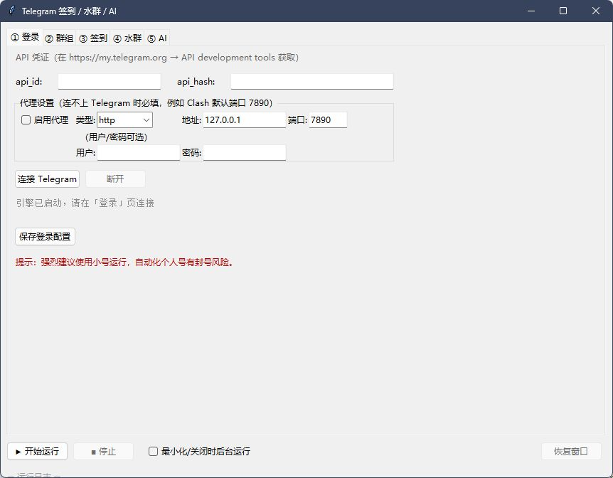
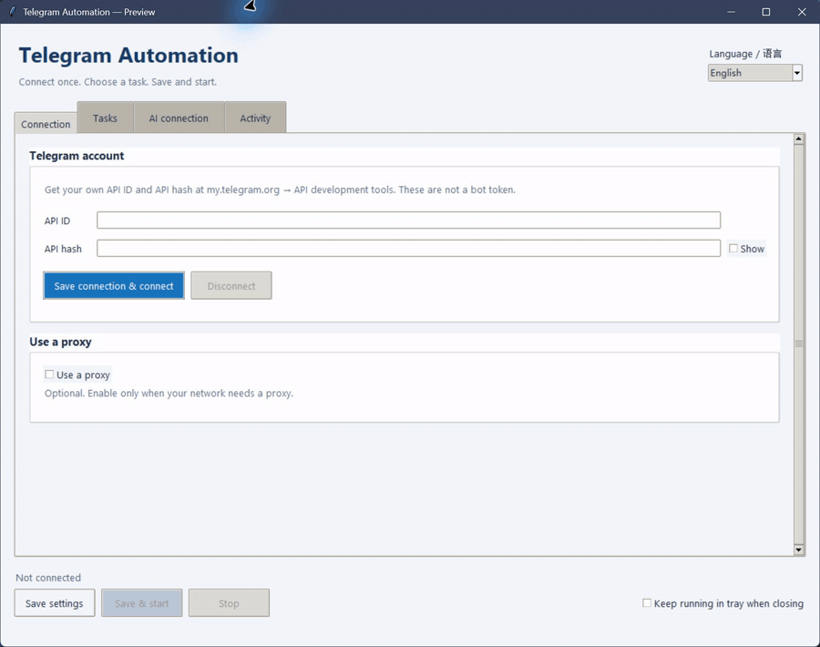

# Telegram Automation GUI · Telegram 签到与 AI 回复桌面工具

在一个窗口里选择 Telegram 群组、设定签到时间，并查看执行日志；需要时再开启定时群聊消息或 AI 回复。基于 **Python、Telethon 和 Tkinter**，界面为中文，使用手机号登录个人账号（Userbot）。

A Python desktop GUI for Telegram user-account automation: scheduled check-ins, configurable group messages, and optional replies through an OpenAI-compatible API. Built with Telethon and Tkinter, with a Chinese-language interface.

**入口 / Start here:** [快速开始](#快速开始--quick-start) · [第一次运行](#第一次运行--first-run) · [常见问题](#常见问题--troubleshooting) · [反馈问题 / Feedback](https://github.com/Marco0431/telegram-automation-gui/issues/new/choose)

## 界面预览 / Interface preview

**登录与代理配置 / Login and proxy settings**



**切换配置页面 / A tour of the settings tabs**



截图与 GIF 使用独立演示配置，只展示页面和设置项：未登录 Telegram、未执行自动化任务，也未调用 AI。接口地址和模型为示例，密钥与目标群为空。

These captures use an isolated demo configuration to show the interface. Telegram is not signed in, no automation tasks are running, and no AI requests are made. The endpoint and model are placeholders; credentials and target groups are empty.

## 选一个用途 / Choose a workflow

| 想完成的事 / Goal | 从哪里开始 / Start with | 是否需要 AI / AI required |
| --- | --- | --- |
| 在指定群里定时发送签到指令 / Scheduled check-in | ② 群组 → 签到群；③ 签到 → 时间与指令 | 否 / No |
| 定时发送自己准备好的句子 / Scheduled messages from your own list | ② 群组 → 水群；④ 水群 → 固定句子池 | 否 / No |
| 在选定群里生成回复 / Replies in selected groups | ② 群组 → AI 回复群；⑤ AI → 接口与触发方式 | 是 / Yes |

适合愿意从 Python 源码运行、且所在群允许自动化的个人账号用户。这里提供的是桌面程序源码；登录使用 Telegram 应用的 `api_id` / `api_hash`，不是 BotFather 的 bot token。

This is a source-based desktop app for a personal Telegram account, with a Chinese UI. It uses Telegram application credentials, not a BotFather bot token. Choose a group where automation is allowed before enabling a workflow.

## 快速开始 / Quick start

需要 Python 3、Tkinter、Telegram 账号，以及在 [my.telegram.org](https://my.telegram.org) 的 **API development tools** 中创建的 `api_id` / `api_hash`。AI 功能另需服务商的 API Key；普通签到和固定句子池不需要 AI 服务。

```bash
git clone https://github.com/Marco0431/telegram-automation-gui.git
cd telegram-automation-gui
python -m pip install -r requirements.txt
python main.py
```

没有 Git 时，可使用仓库的 **Code → Download ZIP**，解压后在该目录执行最后两条命令。启动前可运行 `python -m tkinter` 检查 Tkinter 是否可用；缺失时需通过所用 Python 发行版或系统包管理器安装。

Without Git, download the ZIP from **Code → Download ZIP**, extract it, and run the last two commands in that folder. Check Tkinter with `python -m tkinter`; a small test window should appear. No Telegram login or AI key is needed just to open the GUI.

## 第一次运行 / First run

先登录 Telegram 官方的 [my.telegram.org](https://my.telegram.org)，进入 **API development tools** 创建应用，取得自己的 `api_id` 和 `api_hash`，再填写到本程序。

First, sign in at Telegram's official [my.telegram.org](https://my.telegram.org), open **API development tools**, and create an application to obtain your own `api_id` and `api_hash` for this app.

以“只开启一个群的定时签到”为例：

1. **① 登录**：填写 `api_id` / `api_hash`，按自己的网络环境配置代理，点「连接」。输入带国家区号的手机号、验证码；开启二步验证的账号还需输入密码。
2. **② 群组**：点「刷新群列表」，选一个允许签到的群，加入「签到群」。暂时让「水群」和「AI 回复群」保持为空。
3. **③ 签到**：确认签到指令、`HH:MM` 时间与启用状态，点「保存签到设置」。签到按运行电脑的本地时间安排，并额外随机延迟 0–5 分钟；当天时间已过时会安排到次日。
4. 确认 **④ 水群**、**⑤ AI** 的启用开关关闭，再点底部「开始运行」。它会保存各页当前设置，并运行已启用的功能；日志中会显示下次签到时间。
5. 需要结束时点「停止」。如果勾选「最小化/关闭时后台运行」，关闭窗口会继续运行任务；可从托盘恢复窗口再停止。

**For an initial check-in:** log in on tab ①, refresh groups on tab ②, and add one permitted group to the check-in list. Set the command and local time on tab ③, leaving group chat and AI replies disabled. **开始运行** saves all tabs and starts enabled features; **停止** stops them. Check-ins include a random 0–5 minute delay. Closing the window keeps tasks running when the background option is enabled.

不必复制配置模板即可启动。[config.py](config.py) 是无配置文件时的实际默认值：签到开关开启、目标群为空，水群和 AI 回复关闭。[config.example.json](config.example.json) 是另一份示例，代理开启、各任务关闭，AI 地址和模型也不同；复制前请逐项检查，不要把示例当成已可用的连接配置。

The app can start without copying a config file. Runtime defaults and the example JSON differ: defaults enable check-in with an empty group list, while the example disables tasks and enables a proxy. Review the proxy and provider fields before using the example.

## 功能

- 图形界面配置,无需写代码
- 一键登录个人 Telegram 账号(手机号 + 验证码)
- 自动列出你加入的所有群,勾选即可作为「签到群」或「水群」
- 签到:每日定时 / 手动立即签到,支持多个群、多条签到指令
- 水群:随机间隔从发言池抽句发言,可设活跃时段、间隔范围、多个群
- AI 回复:通过 OpenAI 兼容的 Chat Completions 接口生成回复，可选全部消息或 @ / 回复消息触发，带频率控制
- AI 群聊:读取近期群聊上下文，按设定间隔生成消息；也可使用固定句子池
- HTTP / SOCKS5 代理、二步验证登录、系统托盘后台运行
- 各页保存按钮将配置写入 `config.json`；开始运行时也会保存各页当前设置，日志实时显示

## AI 配置

AI 水群 / AI 回复使用 OpenAI Python SDK 的 Chat Completions 接口，需要填写服务商支持的接口地址与模型：

| 字段 | 示例 |
| --- | --- |
| Base URL | 服务商提供的 OpenAI 兼容 API 地址，例如 `https://api.deepseek.com/v1` |
| API Key | 对应服务商提供的密钥 |
| 模型 | 对应服务商支持的模型 ID；程序默认配置为 `deepseek-chat` |

填好后可在 AI 页点「检测 AI 是否可用」。该按钮先保存 AI 页设置，再向所填接口发送一条简短测试请求，不带群聊历史；结果显示在底部日志。测试和后续 AI 生成都可能产生服务商费用。测试成功只表示当前文本请求可用。

**检测 AI 是否可用** saves the AI settings and sends a short text request to your provider without group history. Read the result in the log. The test and AI-generated replies may incur provider charges.

## 常见问题 / Troubleshooting

| 现象 / Symptom | 先检查 / First check |
| --- | --- |
| `No module named tkinter` | 运行 `python -m tkinter`；为当前使用的 Python 安装 Tkinter / Check Tkinter in the same Python environment. |
| 连接失败 / Connection failed | ① 登录中的代理类型、地址、端口是否与实际代理一致；不需要代理时取消启用 / Match proxy settings to your network, or disable the proxy if unnecessary. |
| 已登录却没有任务 / Logged in but no tasks | 对应目标群是否加入正确列表、功能是否启用，并且已点击「开始运行」 / Check the target list, feature switch, and Start button. |
| 签到没有立刻发送 / Check-in did not send immediately | 定时任务使用电脑本地时间；已过的时刻排到明天，另有 0–5 分钟延迟 / Check local time and the next scheduled run in the log. |
| AI 测试失败 / AI test failed | 核对所填 Base URL、密钥和模型 ID，查看日志返回的错误 / Verify your provider settings and the error in the log. |

## 隐私与安全

- 你的 `api_id` / `api_hash` / API Key / 群信息保存在本地 `config.json`，登录凭证保存在 `userbot.session`。这些文件已被 `.gitignore` 忽略；这不等于加密保护，也不能阻止手动分享或强制提交。
- AI 自动回复会读取最多 10 条近期消息，AI 定时群聊会读取最多 12 条，并将消息文本及发送者名称发送给你配置的 AI 服务商。关闭这些功能后不会触发其自动请求；手动点击 AI 检测仍会发送测试请求。
- 日志可能包含手机号、账号标识、群名、消息内容或接口错误；反馈时仅摘取相关错误并隐去私人信息。
- 公开分享代码时请勿提交 `config.json`、`*.session`、`*.log`。

Credentials are stored locally in `config.json` and `userbot.session`, without application-level encryption. AI replies send up to 10 recent messages; scheduled AI chat uses up to 12, including sender names. The manual AI test sends a request even when automatic AI features are disabled. Redact private information before sharing any log excerpt.

## 风险提示

- 请仅在允许自动化的群中使用，并遵守 Telegram 的服务条款与群规则。
- 频繁自动发言可能触发限流、账号限制或群管理员处置；间隔设置不保证避免这些问题。

## 文件说明

| 文件 | 说明 |
| --- | --- |
| [main.py](main.py) | 入口,Tkinter 图形界面 |
| [engine.py](engine.py) | 核心引擎:Telethon 客户端、签到/水群/AI 任务,与 GUI 通过队列通信 |
| [config.py](config.py) | 默认值与配置读取/保存(`config.json`) |
| [config.example.json](config.example.json) | 配置模板(无敏感信息,可公开) |
| `config.json` | 运行时生成的个人配置(含密钥,已 gitignore) |

## 项目索引 / Project index

[llms.txt](llms.txt) 提供公开、简短的英文项目摘要与源码入口，方便读者和工具定位资料。

## 反馈与参与 / Feedback and contributions

[报告问题 / Report a problem](https://github.com/Marco0431/telegram-automation-gui/issues/new?template=bug_report.md) 时，请写明系统、Python 版本、使用的功能页、复现步骤与脱敏后的错误。安装说明不清楚、代理配置卡住、按钮含义不明确，都值得反馈。改进建议可说明你想完成的任务和当前卡点；也欢迎提交文档修正 PR。

Include your OS, Python version, workflow, reproduction steps, and a redacted error when reporting an issue. Setup difficulties and unclear UI labels are useful feedback too. Documentation corrections are welcome as pull requests.

当前仓库没有提供 `LICENSE` 文件；公开源码不代表已明确授予开放源码许可。需要复制、分发或商用时，请先向维护者确认许可。

No `LICENSE` file is provided. Public source availability does not establish an open-source license; ask the maintainer about permission before copying, distributing, or commercial reuse.
